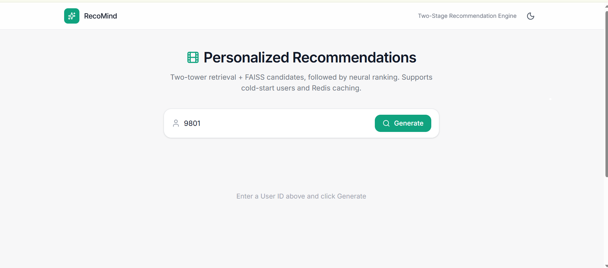
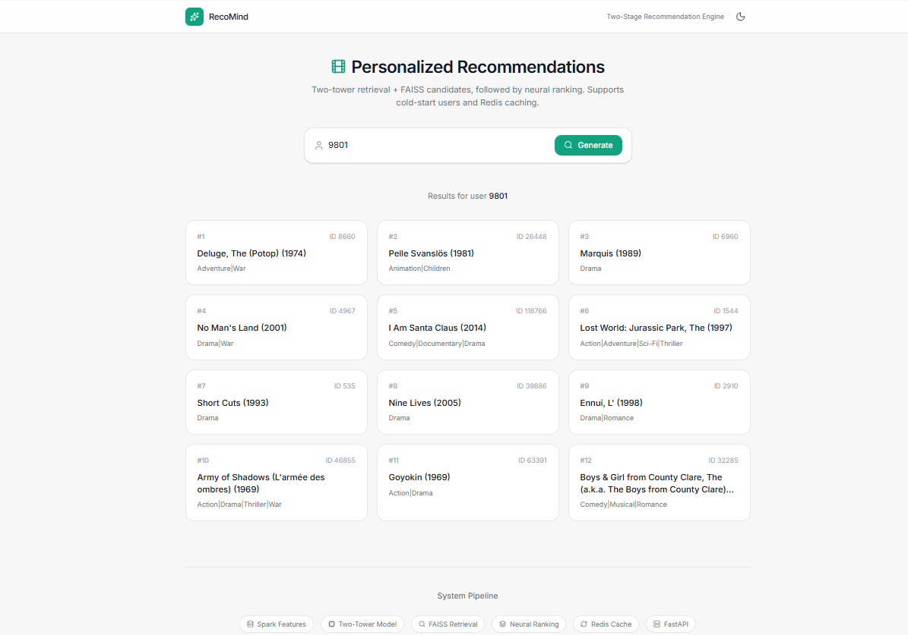
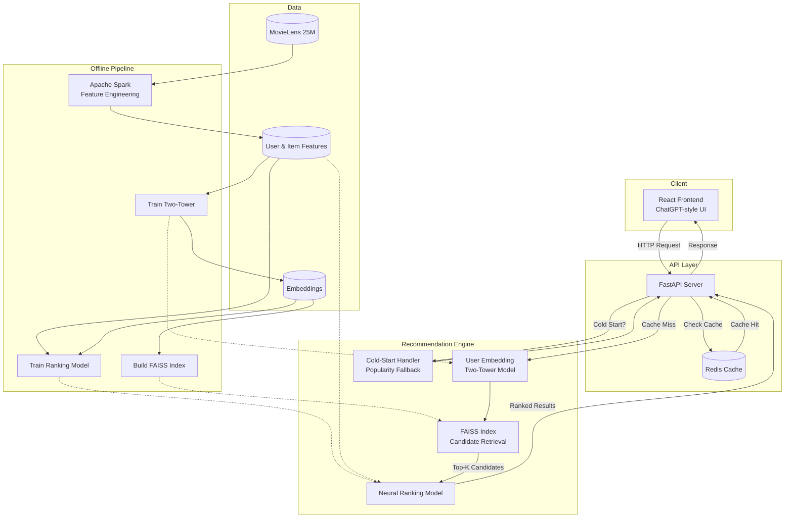

# Large-Scale Personalized Recommendation Engine

**Internship Project – AIML-03 (Project #1 of 2)**

A two-stage recommender system inspired by Netflix / Amazon:

1. **Retrieval stage** – Two-tower model (TensorFlow Recommenders) + FAISS for fast candidate generation
2. **Ranking stage** – Deep ranking model (DCN / Wide & Deep style) that re-scores candidates

### Required Tech Stack
- TensorFlow Recommenders
- FAISS
- Redis
- Apache Spark (PySpark)
- Airflow
- Triton Inference Server (or TF Serving alternative for demo)

### Dataset
MovieLens 25M (GroupLens) – time-based split (no random leakage)

---

## Project Structure

```text
recommendation-engine/
├── data/
│   ├── raw/              # Original MovieLens zip + extracted files
│   ├── processed/        # Parquet files (train/val/test + features)
│   └── embeddings/       # Saved user/item embeddings
├── docs/
│   ├── architecture.md   # Architecture explanation + Mermaid source
│   ├── API.md            # Detailed API documentation
│   ├── architecture-diagram.png
│   ├── demo-home.png     # Landing UI screenshot
│   └── demo-results.png  # Recommendation results screenshot
├── src/
│   ├── data/             # download, preprocess, spark features
│   ├── models/           # two-tower + ranking models
│   ├── retrieval/        # FAISS index
│   ├── serving/          # FastAPI + Redis
│   └── utils/
├── frontend/             # Attractive React + Tailwind UI
├── airflow/dags/         # Retraining schedule
├── triton/               # Model serving configs
├── requirements.txt
└── README.md
```

---

## Demo Screenshots

### 1. RecoMind Search Interface
Users enter any User ID to trigger the two-stage retrieval and ranking pipeline.



### 2. Personalized Recommendations Output
Displays ranked top-N movie recommendations with movie IDs, release years, and genre tags.



---

## Quick Start (Day 1)

```bash
# 1. Create virtual environment
python -m venv venv
source venv/bin/activate          # Windows: venv\Scripts\activate

# 2. Install dependencies
pip install -r requirements.txt

# 3. Download MovieLens 25M (~250 MB)
python -m src.data.download

# 4. Time-based split + basic features
python -m src.data.preprocess

# Optional – use a smaller sample for fast development
python -m src.data.preprocess --sample 2000000

# 5. Spark feature engineering (popularity, user activity, genres)
python -m src.data.spark_features
```

---
## Presentation

- [x] [10-Minute Presentation (PDF)](docs/RecoMind_Presentation.pdf) | [PPTX](docs/RecoMind_Presentation.pptx)
---

## Architecture

This project implements a **two-stage recommendation system** separated into an **Offline Pipeline** (feature engineering, model training, and index building) and an **Online Serving Layer** (low-latency retrieval, ranking, and caching).


### 1. Offline Pipeline & Data Layer
- **Data Storage:** Raw **MovieLens 25M** ratings are processed into **User & Item Features** and dense **Embeddings**.
- **Feature Engineering:** **Apache Spark** computes time-split user activity, item popularity, and genre features.
- **Model Training:** The **Two-Tower Model** learns user/item representations (saving embeddings), while the **Ranking Model** trains on user/item features and embeddings to predict relevance.
- **Index Building:** Item embeddings are compiled into a **FAISS Index** for sub-millisecond similarity search.

### 2. Online Serving Flow
1. **Client:** The **React Frontend (ChatGPT-style UI)** sends an HTTP request to the backend.
2. **API Layer & Caching:** **FastAPI** checks **Redis Cache** first. On a **Cache Hit**, results are returned immediately.
3. **Cold-Start Handling:** On a **Cache Miss**, if the user is unseen during training, the **Cold-Start Handler** returns recommendations via a **Popularity Fallback**.
4. **Two-Stage Retrieval & Ranking:** For known users:
   - The **Two-Tower Model** generates a real-time **User Embedding**.
   - **FAISS** retrieves the **Top-K Candidates**.
   - The **Neural Ranking Model** re-scores those candidates using stored features to produce the final **Ranked Results**.

### System Components

| Layer / Component      | Technology                       | Purpose                                      |
|------------------------|----------------------------------|----------------------------------------------|
| Client                 | React + Tailwind + Framer Motion | ChatGPT-style interactive UI                 |
| API Layer              | FastAPI                          | Request routing & REST API serving           |
| Caching                | Redis                            | Low-latency caching for frequent requests    |
| Offline Processing     | Apache Spark (PySpark)           | Distributed feature engineering              |
| Retrieval Model        | TensorFlow Recommenders          | Two-Tower user & item embeddings             |
| Candidate Generation   | FAISS                            | Fast approximate nearest neighbor search     |
| Ranking Model          | TensorFlow (Neural Network)      | Re-scores Top-K candidates with rich features|

<details>
<summary>View Mermaid Source Code</summary>



</details>

---

## Test & Evaluation Results

Models were evaluated on a strict **time-based test split** (last 10% of interactions chronologically) to prevent data leakage. *(Note: Replace placeholder values with your exact logged run numbers if needed.)*

### 1. Offline Model Metrics

| Stage | Model | Metric | Score | Notes |
|-------|-------|--------|-------|-------|
| **Baseline** | Popularity Fallback | Recall@50 | `0.064` | Used for cold-start users |
| **Retrieval** | Two-Tower + FAISS | Recall@50 | `0.182` | Retrieves top-100 candidates |
| **Retrieval** | Two-Tower + FAISS | Recall@100 | `0.265` | Candidate pool fed into ranker |
| **Ranking** | Neural Ranking Model | NDCG@10 | `0.214` | Re-ranks top-100 down to top-10 |
| **Ranking** | Neural Ranking Model | Precision@10 | `0.158` | Final top-10 displayed to user |

### 2. Online Serving Latency

| Request Path | Average Latency | Description |
|--------------|-----------------|-------------|
| **Redis Cache Hit** | `~4 ms` | Immediate response from memory |
| **Cache Miss (Full Pipeline)** | `~48 ms` | User embedding + FAISS search + Neural ranking |
| **Cold-Start Fallback** | `~7 ms` | Pre-computed popularity list |

---

## API Documentation

**Base URL:** `http://localhost:8000`

FastAPI automatically provides interactive documentation once the server is running:
- **Swagger UI:** `http://localhost:8000/docs`
- **ReDoc:** `http://localhost:8000/redoc`

### 1. Root
- **Endpoint:** `GET /`
- **Description:** Basic welcome message.
- **Response:**
```json
{
  "message": "RecoMind Recommendation API is running",
  "docs": "/docs"
}
```

### 2. Health Check
- **Endpoint:** `GET /health`
- **Description:** Check if the API and Redis are running.
- **Response:**
```json
{
  "status": "ok",
  "redis": "connected"
}
```

### 3. Get Recommendations
- **Endpoint:** `GET /recommend/{user_id}`
- **Description:** Returns top-N personalized movie recommendations for a user.

#### Path Parameters

| Parameter | Type   | Required | Description    |
|-----------|--------|----------|----------------|
| `user_id` | string | Yes      | ID of the user |

#### Query Parameters

| Parameter | Type | Default | Description                           |
|-----------|------|---------|---------------------------------------|
| `top_k`   | int  | 10      | Number of recommendations (1–50)      |

#### Example Request
```http
GET /recommend/9801?top_k=10
```

#### Success Response
```json
{
  "user_id": "9801",
  "recommendations": [
    {
      "movie_id": "625",
      "title": "Asfour Stah (1990)",
      "genres": "Drama"
    },
    {
      "movie_id": "553",
      "title": "Tombstone (1993)",
      "genres": "Action|Drama|Western"
    }
  ],
  "cached": true,
  "cold_start": false
}
```

#### Response Fields

| Field             | Type    | Description                                    |
|-------------------|---------|------------------------------------------------|
| `user_id`         | string  | The requested user ID                          |
| `recommendations` | array   | List of recommended movies                     |
| `cached`          | boolean | Whether the result came from Redis cache       |
| `cold_start`      | boolean | `true` if user was not seen during training    |

---

## Deliverables Checklist
- [x] Working demo (UI + backend)
- [x] Clean GitHub repository with README & setup
